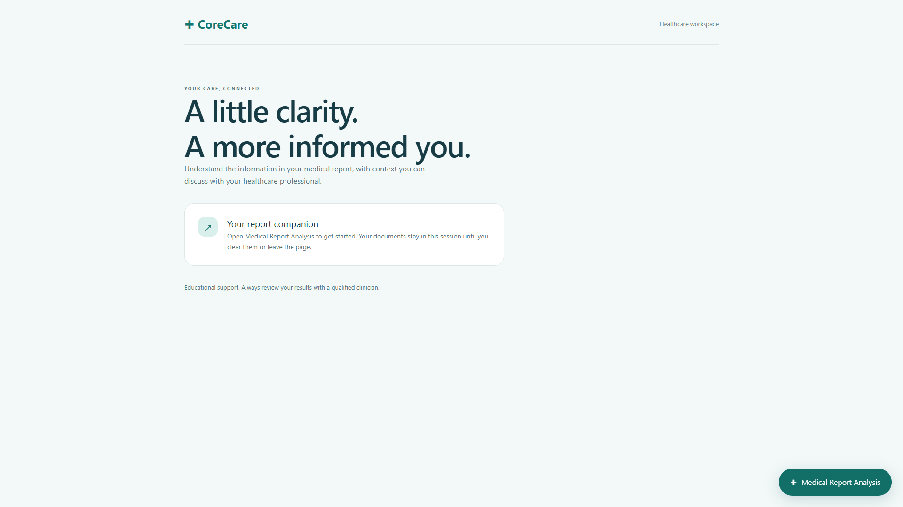
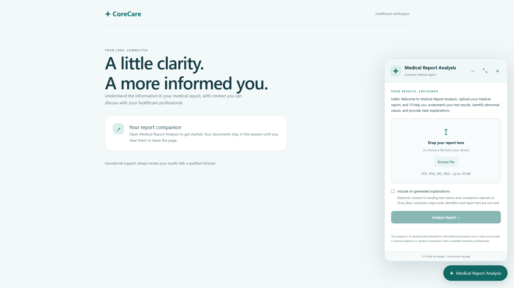
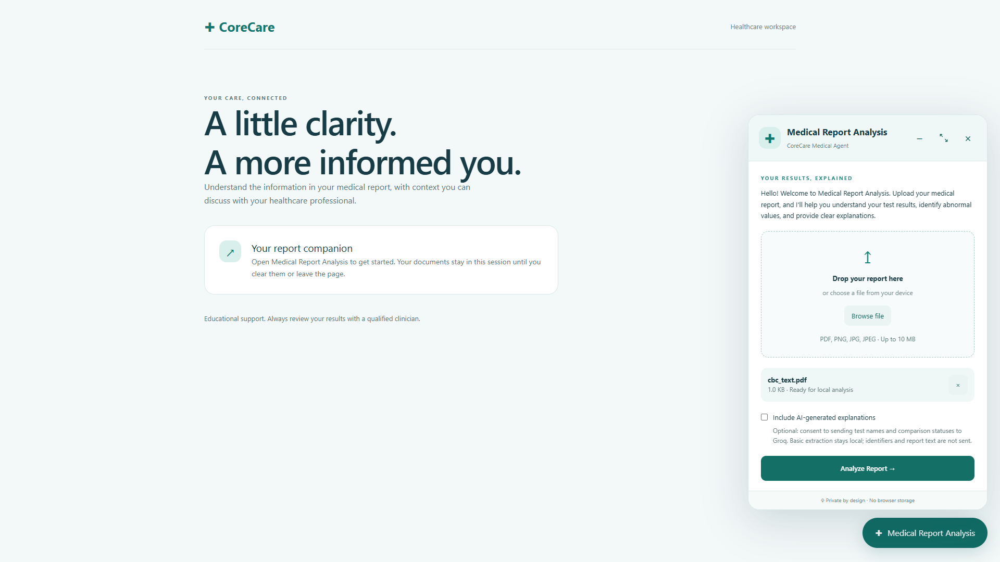
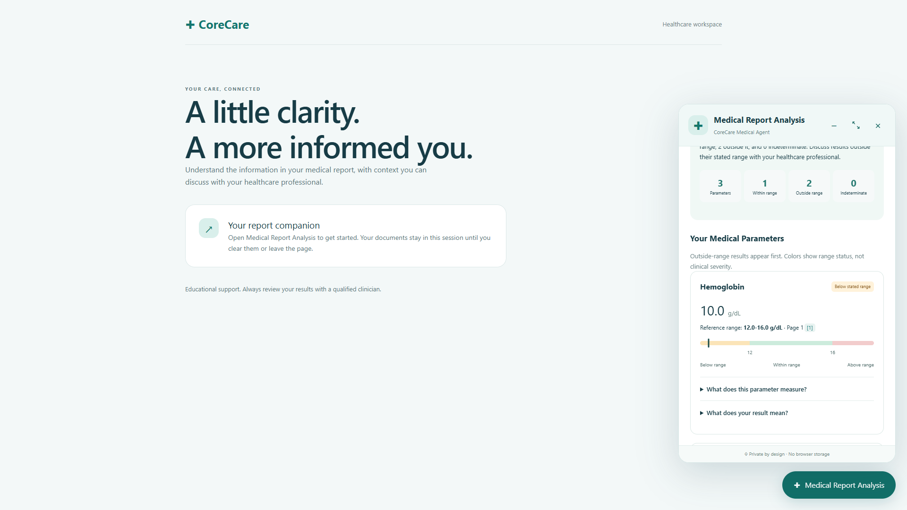
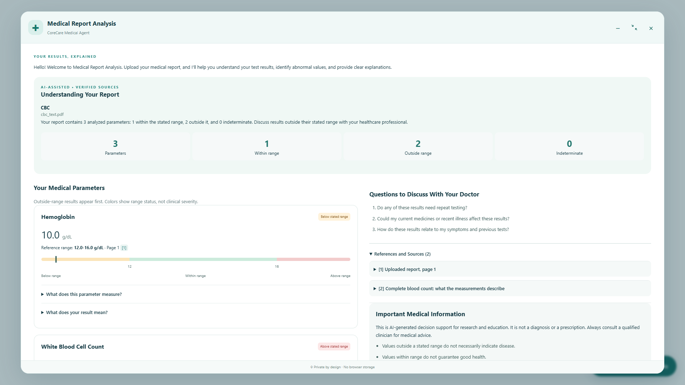
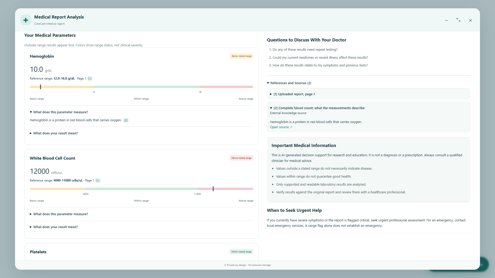
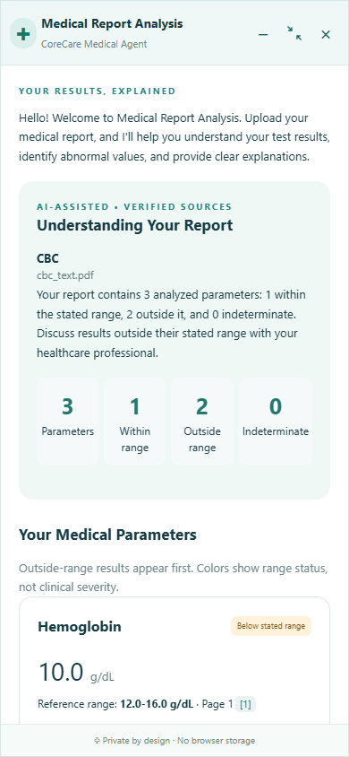

**CoreCare: An LLM-Driven Multi-Agent Framework for Intelligent Healthcare Services**

<!-- A B.Tech major project that builds an application layer for LLM-powered healthcare
services on top of the open-source [ColaCare](https://github.com/PKU-AICare/ColaCare)
research framework. -->

> Medical safety notice: CoreCare is a research/educational project, **not** a medical
> diagnosis system. It is not a substitute for professional medical advice or care.

## Application Screenshots

Actual captures of the running CoreCare frontend and FastAPI backend using the
synthetic CBC fixture at `tests/fixtures/reports/cbc_text.pdf`. No real patient
records are shown. The analysis screenshots include a live Groq explanation
requested with explicit consent, report-derived ranges, and supporting sources.
Desktop captures are 1920 × 1080; the mobile capture is 390 × 844.

### CoreCare Dashboard

The landing page introduces the report companion and its floating launcher.

<p align="center">
  
</p>

### Report Analyzer and Upload

Open the floating analyzer, then select a PDF or image report. The upload example
shows the synthetic CBC PDF selected before analysis.

<table align="center">
  <tr>
    <th>Floating report analyzer</th>
    <th>Synthetic report selected</th>
  </tr>
  <tr>
    <td></td>
    <td></td>
  </tr>
</table>

### Analysis Results

The completed analysis displays measured values, units, the report's reference
ranges, and comparison statuses. The synthetic report contains three parameters:
one within its stated range and two outside it.

<p align="center">
  
</p>

### Maximized Analysis Workspace

The maximized interface provides more room for parameter cards, the report
summary, doctor discussion questions, and sources.

<p align="center">
  
</p>

### AI Explanations and Supporting Sources

An expanded parameter explanation appears alongside doctor discussion questions
and the actual supporting source returned by the application. Citation links
connect explanations to the references shown in the interface.

<p align="center">
  
</p>

### Responsive Mobile View

The same completed analysis adapts to a narrow mobile viewport with vertically
stacked content and a scrollable report panel.

<p align="center">
  
</p>

To reproduce these captures from the `frontend` directory, run
`node scripts/capture-screenshots.mjs`. This starts local servers, uses headless
Chrome through the existing Playwright setup, and makes a live Groq request with
the synthetic fixture and explicit consent. It requires the existing backend
configuration, a configured Groq key, corpus, and Chrome installation. Re-running
the script overwrites these screenshots; generated explanation wording may vary.

## Current Status (Week 4 — Medical Report Analysis)

The online path works end to end: request routing, Groq LLM service, ChromaDB medical
retrieval, and the Patient Assistance agent with safety guardrails.

| Capability | Status |
|---|---|
| `POST /chat` with session memory | Done |
| Groq LLM service (retries, JSON, typed errors) | Done |
| ChromaDB corpus ingest + retrieval | Runtime verified (18 documents, 43 chunks) |
| Intent router (rules first, LLM fallback) | Done |
| Agent 1: Patient Assistance (RAG + citations + guardrails) | Done |
| Agent 2: Medical Report Analysis | Upload, local extraction/OCR, ranges, consent-gated RAG explanation |
| Agent 3: Clinical Record Analysis (predictions) | Stub, Week 3+ |
| Phase 1 model training (AdaCare / MCGRU / RETAIN) | Not started |

## Architecture

```
Doctor -> POST /chat -> Orchestrator -> Router (rules -> LLM fallback)
                                            |
              +-----------------------------+-----------------------------+
              |                             |                             |
      Patient Assistance            Report Understanding          Clinical Record
      (Groq + RAG)                  (upload endpoint)             (stub)
              |                             |                             |
              +-----------------------------+-----------------------------+
                                            |
                    Merge answer + sources -> structured response
```

Every response carries `sources[]` labelled `reference`, `record`, or `model`, so the
UI can show what came from guidelines, the patient record, or a trained model.

## Repository Layout

```
CoreCare/
|
+-- backend/
|   +-- main.py              # FastAPI entrypoint, POST /chat
|   +-- agents/              # Agent implementations + prompts
|   +-- orchestrator/        # Router, dispatch, session memory
|   +-- rag/                 # Corpus ingest CLI + ChromaDB retriever
|   +-- llm/                 # Groq service layer
|   +-- schemas/             # API contracts
|   +-- config/              # Environment-backed settings
|
+-- data/
|   +-- corpus/              # Seed medical references (+ SOURCES.md)
|   +-- chroma/              # Generated vector store (git-ignored)
|
+-- research/
|   +-- colacare/            # Original ColaCare repo (READ-ONLY)
|
+-- scripts/                 # Evaluation helpers
+-- docs/                    # Plans and design notes
+-- tests/                   # Offline test suite
+-- requirements.txt
+-- README.md
```

`research/colacare/` is a clone of the original ColaCare project. It is treated as
**read-only** and must not be modified, deleted, or rewritten.

## Setup

```powershell
python -m venv .venv
.venv\Scripts\activate
pip install -r requirements.txt
```

Create `.env` from the template and add your Groq key
(from <https://console.groq.com/keys>):

```powershell
Copy-Item .env.example .env
# edit .env -> GROQ_API_KEY=gsk_...
```

`.env` is git-ignored. Never commit a key.

## Build the retrieval store

```powershell
.venv\Scripts\python -m backend.rag.ingest --reset
```

The first run downloads the ChromaDB ONNX embedding model (~80 MB) into
`~/.cache/chroma`. Re-runs are incremental and idempotent.

## Running the server

```powershell
.venv\Scripts\python -m uvicorn backend.main:app --reload
```

| Endpoint | Description |
|---|---|
| `GET /` | Health check |
| `GET /config` | Public model/retrieval config (no secrets) |
| `POST /chat` | Route a question to an agent |
| `POST /reports/analyze` | Multipart medical PDF/image analysis |

Example:

```powershell
$body = @{ message = "What are the warning signs of a stroke?" } | ConvertTo-Json
Invoke-RestMethod -Method Post -Uri http://127.0.0.1:8000/chat `
  -ContentType "application/json" -Body $body
```

Response shape:

```json
{
  "answer": "... [1][2]",
  "sources": [
    { "type": "reference", "title": "Stroke: recognising and acting fast",
      "url": "https://www.stroke.org/...", "score": 0.61 }
  ],
  "agent": "patient_agent",
  "intent": "general_question",
  "status": "ok",
  "session_id": "…",
  "disclaimer": "This is AI-generated decision support ..."
}
```

Send `session_id` back to keep conversation context. Emergency messages short-circuit
the LLM and return immediate advice to contact local emergency services. Diagnosis and
prescription requests are refused deterministically.

## Tests

```powershell
.venv\Scripts\python -m pytest
```

All tests are offline: the Groq client and retriever are replaced with fakes, so no API
key or network is needed.

Optional smoke checks:

```powershell
.venv\Scripts\python -m scripts.eval_patient_agent --offline  # retrieval coverage
.venv\Scripts\python -m scripts.eval_patient_agent --live     # writes reports/*.csv
```

## Dependencies

- [fastapi](https://fastapi.tiangolo.com/) / [uvicorn](https://www.uvicorn.org/) — API
- [pydantic](https://docs.pydantic.dev/) / [pydantic-settings](https://docs.pydantic.dev/latest/concepts/pydantic_settings/) — validation and config
- [groq](https://console.groq.com/docs) — LLM inference (OpenAI-compatible)
- [chromadb](https://www.trychroma.com/) — vector store + local embeddings
- [python-dotenv](https://github.com/theskumar/python-dotenv) — `.env` loading

> Groq is the inference provider. xAI's Grok is a different product; switching would
> only require changing `GROQ_BASE_URL` and `LLM_MODEL`.

## Roadmap

- Week 1: Foundation (FastAPI skeleton, tests, repo layout) — done
- Week 2: Online phase foundation: Groq, RAG, Agent 1, orchestrator, `/chat` — done
- Week 3: Phase 1 models (AdaCare / MCGRU / RETAIN) + EHR record retrieval
- Week 4: Medical Report agent (upload, OCR, lab explanation) — implemented; runtime setup below
- Week 5: Clinical Record agent (predictions with LLM explanation)
- Week 6: Multi-agent collaboration, fusion, evaluation, UI

## Medical Report Agent

The report path is independent of EHR retrieval and clinical ML:

```text
POST /reports/analyze (multipart)
 -> request/content/size validation
 -> isolated PDF text extraction or Tesseract OCR (page attribution)
 -> deterministic laboratory parser + Pydantic validation
 -> deterministic comparisons against the report's own ranges
 -> optional existing Chroma retrieval + existing Groq JSON service
 -> validated educational excerpts + numbered record/reference sources
```

PDFs with selectable text, scanned PDFs, PNG and JPEG are supported. Common CBC,
glucose/HbA1c, lipid, liver, kidney and thyroid labels are recognized. Original
measurement strings and units are retained. Reference ranges are never invented;
missing units, qualified values, incompatible range units and ambiguous ranges
produce `indeterminate`. OCR results always carry uncertainty and require human
verification before range comparisons can be trusted.

### Setup and use

Install the updated `requirements.txt`. Text PDFs need no OCR executable. For scans,
install Tesseract separately, including English language data. On Windows:

```powershell
winget install --id UB-Mannheim.TesseractOCR --exact
# If it is not on PATH, set in .env:
# TESSERACT_CMD=C:/Program Files/Tesseract-OCR/tesseract.exe
```

On Debian/Ubuntu, the runtime package is `tesseract-ocr`. PDF rasterization uses
PyMuPDF directly; Poppler is not required. Restart the server after changing `.env`.
Re-run the existing ingest command to add `data/corpus/lab_tests.json` to the same
Chroma collection. The six new educational summaries link to MedlinePlus; source
attribution is recorded in `data/corpus/SOURCES.md`.

```powershell
.venv\Scripts\python -m backend.rag.ingest
# Local processing only; no report information is sent to Groq:
curl.exe -X POST http://127.0.0.1:8000/reports/analyze -F "file=@synthetic-report.pdf"
# Explicit consent to send canonical test names and comparison statuses to Groq:
curl.exe -X POST http://127.0.0.1:8000/reports/analyze -F "file=@synthetic-report.pdf" -F "external_llm_consent=true"
```

Only use synthetic reports for demonstrations. Consent defaults to false and cannot
be bypassed by environment configuration. Even with consent, the application sends
only canonical test names and comparison statuses, plus retrieved reference evidence.
It does not send values, units, original labels, page text, filenames, patient
identifiers, or chat history. No consent means no report retrieval or Groq call.

The response includes `agent: medical_report`, `status: completed|partial`, report
type, page metadata, `tests[]`, summary, warnings, `external_llm_used`, disclaimer
and `sources[]`. Each test has `source_type: record`; source objects preserve the
existing `type: record|reference` convention. Citations `[n]` address `sources[n-1]`
in stable order. Local facts are rendered deterministically. Groq selects exact,
complete educational sentences from retrieved evidence; validation rejects invented
citations, altered excerpts, numerical medical claims and treatment instructions.
The result includes limitations and questions to discuss with a clinician.

`partial` means extraction, parsing, comparison or educational explanation was
incomplete, uncertain or unavailable (including absent external consent). Read the
warnings rather than interpreting this status as a clinical assessment. Errors use
`detail: {code, message}` with 413 for limits, 415 for unsupported content, 422 for
invalid/unreadable content, 408/504 for timeouts, 429 for capacity, and 503 for a
missing OCR runtime. `/docs` documents the multipart request.

### Privacy, limits and known limitations

Uploads are stateless. `/chat` report requests return upload instructions (or immediate emergency guidance) and store
only neutral guidance placeholders. Recognized pasted laboratory measurements route
locally without LLM intent classification. General questions about a test retain
the existing patient-education route. No report-reference cache or automatic reuse of
past results is implemented. Existing general, record and prediction routing remains
unchanged; the clinical agent remains unavailable.

Raw files are not retained. Multipart spools are closed on success/failure. Each
native worker uses a private temporary directory, removed after exit; OCR child
processes are terminated during timeout cleanup. Defaults: 10 MiB per file, ten PDF
pages, twenty million image pixels, one hundred thousand extracted characters,
thirty seconds for upload, fifteen seconds per OCR operation, and a shared
one-hundred-twenty-second processing deadline. Two report jobs are admitted per
server process. Worker-tree RSS is sampled against a configurable 512 MiB limit;
this is a monitored limit, not an OS-enforced allocation quota. Brief overshoot is
possible. These bounds do not replace deployment resource limits.

Encrypted (including empty-password), repaired, active-content and attachment-bearing
PDFs are rejected. Limits and `TESSERACT_CMD` are configured through `.env.example`.
No application logs contain report bodies or filenames; shared LLM retry logs record
exception types rather than provider messages.

The parser supports conventional label/value/unit/range rows, including same-row PDF
table cells, simple inequalities and repeated tests. It does not reconstruct arbitrary
multi-column layouts, infer demographics/dates/specimens, convert units, repair OCR
measurements, interpret imaging findings, or infer missing ranges. Unknown rows are
not explained. OCR works best with clear English scans; EXIF orientation and
confident Tesseract orientation detection are supported. Handwriting and poor scans
may fail. Ambiguity is preserved instead of using unconstrained LLM parsing.

A normal result does not guarantee health; an abnormal result is not a diagnosis.
The agent does not prescribe, calculate critical thresholds, or provide clinical
triage. It advises professional review and directs emergencies to local emergency
services. Authentication and user access controls remain deployment work inherited
from Week 2; do not expose this research API to real patient traffic without them.

### Verification

```powershell
.venv\Scripts\python -m pytest -q
.venv\Scripts\python -m pytest tests/test_reports.py -q
```

Tests use synthetic documents, real PDF/image processing, deterministic fake OCR,
fake retrieval and fake Groq transports. They require no external network or API key.
The fake transport tests exercise the existing service's JSON repair and deadlines.
Real OCR and live Groq/Chroma smoke checks are separate runtime checks; the offline
suite does not establish their availability. See `WEEK4_IMPLEMENTATION_REPORT.md`
for results and environment blockers observed during implementation.


Windows runtime verification on 2026-11-14 confirmed real OCR with Tesseract
`5.4.0.20240606`, synthetic uploads over loopback HTTP, and actual Chroma retrieval.
The working executable is `.runtime/tesseract-portable/tesseract.exe`; ignored
`.env` configures its absolute path. No global PATH or Windows security settings
were changed. Windows-only pins `grpcio==1.76.0` and `pybase64==1.4.2` satisfy
Chroma's dependencies and avoid builds blocked by this machine's policy.
Other managed machines may make different policy decisions.

```powershell
.venv\Scripts\python -m scripts.verify_report_runtime --consent
```

This starts/stops a real loopback-only Uvicorn server and verifies generated synthetic
PNG/scanned-PDF/text-PDF uploads, original measurements/ranges, production isolated
retrieval, response schemas and citation indices. Evidence is saved under ignored
`reports/runtime/`. No fake OCR, database or LLM is used. With no Groq key configured,
local checks pass but the command returns nonzero with `blocked_missing_key`; a live
explanation and external citations remain unverified. Configure a key locally before
explicitly rerunning with consent; never paste it into chat. The implementation
report records the working portable installation and exact verification commands.


Live Groq verification now passes with `openai/gpt-oss-20b`. The Groq SDK base URL
is the origin `https://api.groq.com`; legacy URLs ending in `/openai/v1` are
normalized because the pinned SDK already supplies that path. Defaults use a
2048-token budget and low GPT-OSS reasoning effort. Existing `.env` overrides take
precedence, so an unavailable old model must also be updated locally. The synthetic
verifier returned a completed consented response with validated record/reference
citations; all 148 offline tests pass. See the implementation report for the original
failure trace and the fixes. Missing keys or invalid citations still fail verification.


### PDF upload fixtures and troubleshooting

Generate the labelled synthetic samples and inert security regression PDFs:

```powershell
.venv\Scripts\python -m scripts.generate_report_fixtures
.venv\Scripts\python -m uvicorn backend.main:app --reload --host 127.0.0.1 --port 8001
```

If CoreCare is already running on 8001, reuse it rather than starting a competing
server. Open `http://127.0.0.1:8001/docs`, select `POST /reports/analyze`, and choose
`tests/fixtures/reports/cbc_text.pdf` using the file picker. Clear/reselect any old
file selection. Use `external_llm_consent=false` for local processing; HTTP 200 with
`status=partial` and an absent-consent warning is expected. Explicit `true` allows
live Groq educational explanations. The sample contains synthetic Hemoglobin 10.0,
WBC 12000 and platelets 250000, each with its own stated range and unit.

PDF active-content checks inspect actual parsed names, including escaped names and
compressed objects. Harmless keyword text in metadata or page streams is accepted;
attachments and unsupported actions remain rejected. Do not bypass an `unsafe_pdf`
error for a real document. PNG/JPEG and scanned-PDF samples are in the same directory;
OCR readings remain uncertain even when the synthetic values are recovered correctly.

```powershell
.venv\Scripts\python -m pytest tests/test_pdf_security.py -q
.venv\Scripts\python -m scripts.verify_pdf_upload --base-url http://127.0.0.1:8001 --consent
```

The 2026-11-24 verification passed 189 offline tests and the actual HTTP/OCR/Groq
checks. The original supplied `test_report.pdf` was accepted before and after the
fix; its historical Swagger rejection was not reproducible. An independent harmless
metadata false positive was reproduced and fixed with identical-byte evidence.
See ignored `reports/runtime/week4_pdf_fix_verification.md` for complete results,
file lists, response examples and exact manual Swagger instructions.


## Floating Report Analyzer frontend

This repository had no existing frontend, dashboard or authentication client. The new
`frontend/` app provides a small host workspace and a reusable React/TypeScript
`ReportAnalyzer` component styled with Tailwind and custom healthcare theme CSS.
No existing dashboard was replaced. The report agent and upload contract are unchanged.
`GET /config` now additionally returns public `report_upload` limits/formats/time budget.

Run in separate project-root terminals:

```powershell
.venv\Scripts\python -m uvicorn backend.main:app --host 127.0.0.1 --port 8001
npm.cmd ci --prefix frontend
npm.cmd run dev --prefix frontend
```

Open `http://127.0.0.1:5173`. The Vite proxy forwards `/config` and `/reports` to
`http://127.0.0.1:8001`. Override its target with `CORECARE_BACKEND_URL` in the terminal
if needed. `frontend/.env.example` documents optional `VITE_API_BASE_URL` for a
same-origin deployment prefix. Production hosting must serve `frontend/dist` and
reverse-proxy those API paths to FastAPI; the dev proxy is not in the static build.
Do not place API keys in frontend environment variables. No CORS relaxation was added.

Click **Report Analyzer**, browse or drop `tests/fixtures/reports/cbc_text.pdf`, and
select **Analyze Report**. With the checkbox unchecked, results are local and may be
partial because external education is absent. Explicitly checking the box sends
`external_llm_consent=true` alongside the `file` multipart field to the existing
`POST /reports/analyze`. It permits the backend's Groq workflow. Results map backend
`tests`, `summary`, `warnings`, `sources` (numbered in their existing order),
`external_llm_used`, `status`, and `disclaimer` without invented clinical classifications.
The API service validates response shapes and safely handles errors/links.

Try minimize/close and reopen: the in-memory state survives, including in-flight work.
Use **Clear current report and results** or **Analyze another report** to remove it.
Leaving the page clears it. No report data is written to browser storage or logs;
no object URLs are created. In an authenticated host, render
`<ReportAnalyzer sessionKey={user?.id ?? "logged-out"} />` so identity/logout changes
abort the request and clear sensitive state. There is no existing login mechanism in
this repository to integrate. Client abort does not guarantee cancellation of work
already accepted by the backend. The panel uses an indeterminate loading state,
not invented stage progress. CSS respects reduced motion and mobile safe areas.

Verification:

```powershell
npm.cmd run lint --prefix frontend
npm.cmd run typecheck --prefix frontend
npm.cmd test --prefix frontend
npm.cmd run build --prefix frontend
npm.cmd run smoke --prefix frontend
.venv\Scripts\python -m pytest -q
```

Frontend: 11 tests passed; lint, TypeScript and production build passed. Backend: all
189 tests passed. The Chrome smoke test starts/stops temporary servers on 18011/15174,
uploads a real synthetic PDF through the UI, checks result rendering and retained
state, tests a 375px mobile viewport, keyboard focus and empty browser storage.
It requires installed Chrome; screenshots are saved to `reports/runtime/ui/`.
No live external AI call is made by this smoke test. AI-result rendering and consent
request construction are covered by offline tests; the backend's prior live workflow
is documented separately. No commits or pushes are performed.

Created frontend files: `package.json`, `package-lock.json`, `tsconfig.json`,
`vite.config.ts`, `eslint.config.js`, `index.html`, `.env.example`, `src/main.tsx`,
`src/style.css`, `src/ReportAnalyzer.tsx`, `src/api.ts`, `src/setup.ts`,
`src/ReportAnalyzer.test.tsx`, and `scripts/smoke.mjs`. Modified backend file:
`backend/main.py` (public limits only). `.gitignore` excludes frontend dependencies,
build output and TypeScript cache files.


### Medical Report Analysis window modes

The floating launcher and panel are now named **Medical Report Analysis**. Header
controls are Minimize, Maximize/Restore, Close. Display state (`open`, `maximized`)
is independent of file/consent/results/request state: minimize or close preserves
that session and reopening returns to the previous size. Maximize never submits
another request. Escape restores a maximized window; a second Escape hides the
normal panel. Only explicit reset or identity changes clear report data.

Expanded mode uses a 94% centered viewport with a backdrop, background scroll lock,
inert background content and modal semantics. Results split into parameter overview/
measurements and explanations/warnings/citations on desktop; screens up to 800px
use one column. Mobile fills the available screen. Header/privacy footer stay fixed
while the body scrolls. All controls have labels/tooltips; reduced motion is respected.
Inline SVG window controls match the existing icon style; no icon dependency was added.

Manual verification: run the existing backend/frontend commands above, open the
launcher, maximize before uploading, restore, upload a synthetic fixture, then change
modes while loading or after results arrive. Minimize/reopen should retain the previous
mode and report. Check Escape twice and repeat at a narrow viewport. All 14 frontend
tests, TypeScript checks, lint and production build passed. The Chrome smoke test
passed real local upload, expanded two-column results, mode retention, Escape restore,
scroll locking and mobile bounds; screenshots are in `reports/runtime/ui/`.

This enhancement modifies only `frontend/src/ReportAnalyzer.tsx`, `src/style.css`,
`src/main.tsx`, `src/ReportAnalyzer.test.tsx`, `scripts/smoke.mjs` and this README.
It changes no backend API, consent, extraction, RAG or authentication functionality.


### Structured medical explanations

The old wall of text was primarily assembled locally: authoritative measurements,
validated Groq-selected quotations, repeated educational prefixes, limitations and
questions were concatenated into `summary`. It was not free-form LLM prose. The
legacy field and its citation numbering remain unchanged for existing clients.

The response now additionally contains `explanation` and each measurement has a
stable response-scoped `parameter_id` (for example `parameter-1`). The structured
object includes `mode` (`local`, `fallback`, `llm_assisted`), `overall_summary`,
`parameter_explanations`, `educational_context`, `doctor_discussion_questions`,
`limitations`, `medical_disclaimer`, `urgent_care_guidance`, and `citation_ids`.
Each parameter explanation links by ID and contains `what_it_measures` (verified
cited sentences), a deterministic `range_explanation`, and record citation IDs.
No authoritative values or classifications are generated by the model.

The prompt still requests the strict existing JSON selection schema (`excerpts`
with integer `source` and verbatim `quote`, plus validated `question_ids`). It now
prioritizes outside-range tests, simple concise sentences, what tests measure and
no repetition. Numeric IDs are required; numerical clinical claims, altered quotes,
unsupported sources, prescriptions and diagnoses remain rejected. The same Groq
service handles JSON repair and typed failures. We do not rely on provider-specific
structured-output support or allow ungrounded paraphrases merely for presentation.
Pydantic validates the additive schema; exact source validation precedes its assembly.

The structured builder associates unambiguous test-label matches with their cards;
unassigned verified sentences appear once under About These Tests. Missing verified
context is shown explicitly, never invented. Without consent there are no report RAG
or LLM calls: only local measurements, range meanings, standard questions and safety
information are structured. Provider/validation failure uses the same schema with
`mode=fallback`, preserves values/statuses and clearly labels unavailable context.
`external_llm_used` continues to indicate a provider attempt, so the structured mode
is what identifies validated LLM-assisted content versus fallback content.

The new UI shows Understanding Your Report and statistics, abnormal-first parameter
cards, Questions to Discuss With Your Doctor, clickable source references, Important
Medical Information and separate conditional urgent-care guidance. Local safety text
is consolidated instead of repeating the legacy summary. Maximize uses two columns;
normal/mobile use the same single-column content. Old servers without `explanation`
retain the legacy renderer. No browser storage or window-state behavior was changed.

Reference indicators are presentation only: marker/boundary percentages are calculated
from the extracted finite numeric value and compatible two-sided range. The indicator
never determines status. Missing/mismatched units, one-sided/qualitative/reversed or
missing ranges, uncertainty and indeterminate statuses use text. Colors describe
range position, not clinical severity. Every card retains the original value/unit,
reference range and source page.

Files for this enhancement:

- `backend/schemas/report.py`, `backend/reports/parser.py`: additive typed structure and IDs.
- `backend/reports/explanation.py`, `backend/reports/structured_explanation.py`,
  `backend/agents/report_agent.py`: validated selection, structured assembly, fallback.
- `tests/test_structured_explanation.py`: eight new consent/safety/schema/fallback cases.
- `frontend/src/api.ts`, `src/ReportAnalyzer.tsx`, `src/ReportPresentation.tsx`,
  `src/rangeGeometry.ts`, `src/style.css`: typed presentation and range calculations.
- `frontend/src/ReportPresentation.test.tsx`: eleven new presentation/math/citation cases.
- `frontend/scripts/smoke.mjs`: real desktop/mobile structured-result verification.
- `README.md`: this implementation and usage description.

Verification on 2026-11-27: 197 backend tests and 25 frontend tests passed. TypeScript,
lint, production build and real Chrome smoke checks passed. Existing Zod bundle
annotation warnings are harmless. The synthetic live verifier also returned
`live_groq=verified` and `overall=verified_requested_checks`; the additive explanation
was LLM-assisted with IDs matching the actual tests and valid source references.
A sanitized example is in `reports/runtime/structured_explanation_example.json`.

```powershell
.venv\Scripts\python -m pytest -q
npm.cmd test --prefix frontend
npm.cmd run typecheck --prefix frontend
npm.cmd run lint --prefix frontend
npm.cmd run build --prefix frontend
npm.cmd run smoke --prefix frontend
.venv\Scripts\python -m scripts.verify_report_runtime --consent
```

To inspect manually, run the existing backend/frontend startup commands, open Medical
Report Analysis, upload a synthetic CBC fixture and analyze with consent off. Review
local labels, cards, range indicators, questions and safety information. Reset and
explicitly opt in to test sourced LLM assistance. Click a compact citation to expand
its actual source. Maximize, restore and minimize/reopen; content must remain unchanged.
Repeat on a narrow screen and with a scanned fixture, which must stay indeterminate.

Limitations: educational sentences remain conservative exact excerpts, so unavailable
or ambiguous test-specific context is explicitly absent; the system does not generate
free-form diagnoses or replace clinician interpretation. Parameter IDs are stable
within the analyzed report, not persistent identifiers across future uploads. Existing
OCR, document-layout, deployment-access and provider-availability limits remain.
No unrelated agent, report-security rule or API endpoint was rebuilt.
